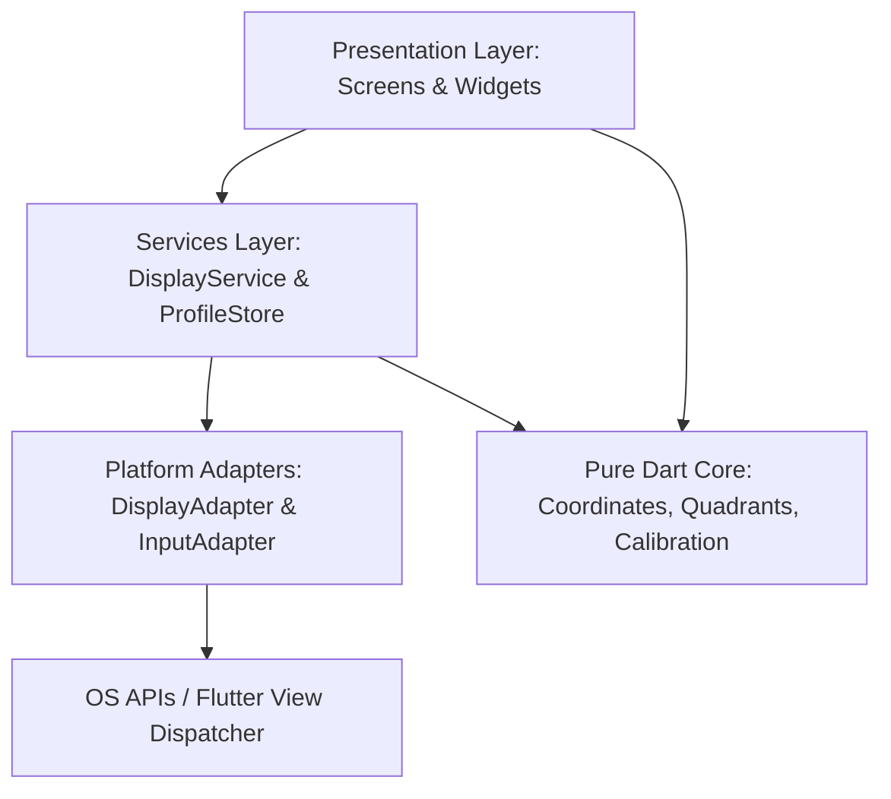

# MacTouch — Architecture Documentation

MacTouch is a desktop utility for display inspection, coordinate visualization, and calibration-data management built with Flutter and Dart.

## Architectural Principles

1. **Separation of Pure Math from UI and Native APIs**:
   All coordinate normalization, bounding-box checks, quadrant region mapping, and affine calibration computations reside in `lib/core/` as pure Dart code with zero dependencies on Flutter widgets or native platform bindings.

2. **Explicit Named Coordinate Spaces**:
   Coordinate values are never mixed implicitly. Every calculation is typed or explicitly contextualized within one of four named spaces:
   - **Logical Points**: OS-reported desktop coordinates used by Flutter's layout engine.
   - **Physical Pixels**: Actual device hardware pixels (`physical = logical * scaleFactor`).
   - **Normalized Coordinates**: Dimensionless coordinates `(u, v) ∈ [0, 1]` relative to a specific display's logical bounds.
   - **Desktop-Global Coordinates**: Desktop layout space that can span multiple physical monitors and feature negative origins.

3. **Honest Capability Reporting**:
   No fabricated data. If an OS feature (such as native multi-display enumeration or global input hooks) is unavailable or unverified, the app explicitly reports `unsupported` or `partial`.



---

## Directory Structure

```
mactouch/
├── lib/
│   ├── main.dart                          # App entry point & dependency wiring
│   ├── app.dart                           # Root MaterialApp & desktop NavigationRail shell
│   ├── core/
│   │   ├── coordinates/
│   │   │   └── coordinate_spaces.dart     # CoordinatePoint, NormalizedPoint, DisplayBounds, CoordinateMapper
│   │   ├── regions/
│   │   │   └── quadrant.dart              # Quadrant enum (Q1-Q4), getQuadrant, Region, RegionMap
│   │   └── calibration/
│   │       └── affine_calibration.dart    # AffineCalibrator, least-squares normal equations, error metrics
│   ├── models/
│   │   ├── capability_status.dart         # CapabilityLevel, PlatformCapabilities
│   │   ├── display_info.dart              # DisplayInfo, DisplayBounds, DisplayValueStatus
│   │   └── calibration_profile.dart       # CalibrationProfile, JSON serialization
│   ├── platforms/
│   │   ├── display_adapter.dart           # DisplayAdapter, FlutterWindowDisplayAdapter, SimulatedDisplayAdapter
│   │   └── input_adapter.dart             # InputAdapter, UnsupportedInputAdapter
│   ├── services/
│   │   ├── display_service.dart           # Display enumeration & active selection management
│   │   └── profile_store.dart             # Versioned local JSON persistence
│   ├── screens/
│   │   ├── dashboard/                     # Canvas, Quadrant overlay, Pointer simulator, Numeric readout
│   │   ├── calibration/                   # Sample entry, affine transform solver, test transform
│   │   └── settings/                      # Platform capability truth table, display adapter switch
│   └── widgets/
│       ├── capability_badge.dart          # Status badges & detailed capability cards
│       ├── coordinate_readout.dart        # Monospace live coordinate display across spaces
│       ├── display_canvas.dart            # Interactive display preview & pointer event listener
│       └── quadrant_overlay.dart          # 4-quadrant visual division & midpoint lines
├── test/
│   ├── coordinate_test.dart               # Normalization, negative origins, boundaries, invalid bounds
│   ├── calibration_test.dart              # Affine solving, collinearity rejection, residual errors, JSON store
│   └── widget_test.dart                   # Desktop shell, canvas, quadrant rendering, navigation
├── docs/
│   ├── architecture.md                    # This document
│   ├── platform-capabilities.md           # OS capability matrix & permission realities
│   └── limitations.md                     # Hardware truth & non-goals
└── pubspec.yaml                           # Flutter dependencies & metadata
```

---

## Core Math & Coordinate Engine

### 1. Normalization & Desktop Bounds
For display bounds defined by `(left, top, width, height)`:
$$u = \frac{x - \text{left}}{\text{width}}, \quad v = \frac{y - \text{top}}{\text{height}}$$

- **Negative Desktop Origins**: Secondary displays placed to the left or above the primary monitor have negative desktop coordinates (e.g. `left: -1920, top: 0`). The normalization math explicitly accounts for this offset.
- **Edge Behavior**:
  - `toNormalized(x, y)` returns raw values and indicates `isInBounds` (permitting values $< 0$ or $> 1$ for out-of-bounds detection).
  - `toNormalizedClamped(x, y)` clamps values strictly to $[0, 1]$ for visual representation on the target canvas.

### 2. Quadrant Boundary Ownership
The display is partitioned into four quadrants at $u = 0.5$ and $v = 0.5$:
- **Q1 (Top-Left)**: $u \in [0, 0.5), v \in [0, 0.5)$
- **Q2 (Top-Right)**: $u \in [0.5, 1], v \in [0, 0.5)$
- **Q3 (Bottom-Left)**: $u \in [0, 0.5), v \in [0.5, 1]$
- **Q4 (Bottom-Right)**: $u \in [0.5, 1], v \in [0.5, 1]$

**Boundary Ownership Rule**: Points falling exactly on midpoints ($u = 0.5$ or $v = 0.5$) belong deterministically to the higher-index quadrant (Q2, Q3, or Q4). Points outside $[0, 1]$ return `null`.

### 3. Affine Calibration Engine
Maps source (simulated or manual input) points to destination (target display) coordinates:
$$\begin{pmatrix} x' \\ y' \end{pmatrix} = \begin{pmatrix} a & b \\ d & e \end{pmatrix} \begin{pmatrix} x \\ y \end{pmatrix} + \begin{pmatrix} c \\ f \end{pmatrix}$$

- **Degeneracy Check**: Rejects inputs with fewer than 3 points, or where source points are collinear (via cross-product vector verification).
- **Least-Squares Solution**: Formulates the normal equations $A^T A \mathbf{p} = A^T \mathbf{b}$ and solves the symmetric $3 \times 3$ system via Cramer's rule.
- **Error Reporting**: Computes and displays Root-Mean-Square (RMS) residual error and Maximum residual error across all correspondences.

---

## Persistence Architecture

- **Store Format**: Versioned local JSON (`ProfileStoreDocument`).
- **Schema Version**: `version: 1`.
- **Default Location**: `~/.mactouch/profiles.v1.json`.
- **Privacy & Telemetry**: Zero telemetry, zero cloud dependencies, zero external network requests.
